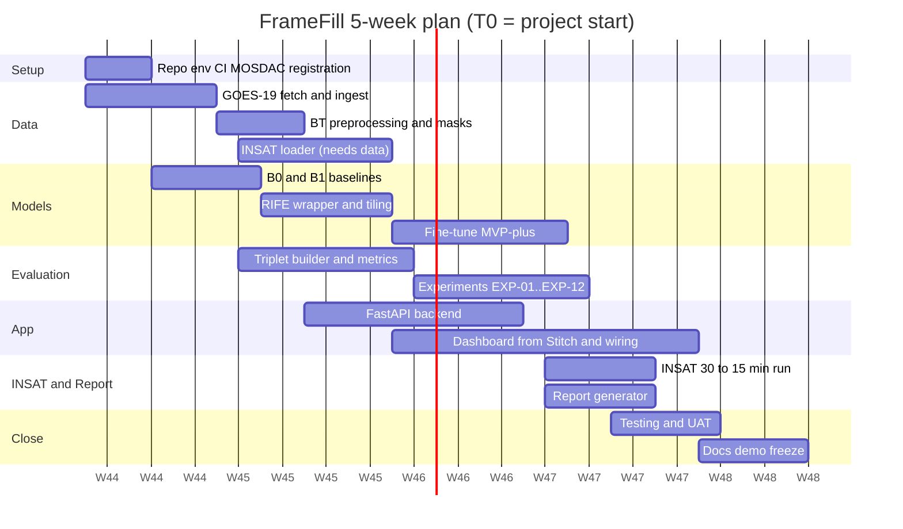

# 01 — Planning and Initiation (Documents 1–8)

**Package version:** 0.1 Draft · **Date:** 2026-10-25 · All content is *proposed*; nothing is approved or tested.

---

## Doc 1 — Project Proposal
**Version 0.1 · 2026-10-25 · Purpose:** Concise pitch of the project to mentors/judges (replace with the organiser's template if one is supplied).

**Title:** FrameFill — AI Temporal Interpolation for Satellite Imagery
**Problem:** GEO satellite cadence (INSAT ≈30 min; GOES/Himawari ≈10 min) hides short-lived convective and cyclonic evolution.
**Proposal:** A reproducible pipeline and dashboard that (a) reads thermal-IR (~10 µm) brightness-temperature frames from `.nc`/`.h5`, (b) synthesises intermediate frames with optical-flow-based methods (classical flow-warp and RIFE), (c) writes CF-style `.nc` outputs with every synthetic frame flagged, (d) validates against held-out *observed* frames, and (e) applies the best model to INSAT-3DS to produce 15-min animations.
**Novelty/Value (honestly stated):** Not a new architecture. The value is a *scientifically defensible adaptation*: BT-preserving I/O, ground-truth hold-out protocols, cloud-specific metrics, baseline comparison, and transparent limits.
**Expected outputs:** Code repo; FrameFill-NC files; web dashboard; evaluation report (HTML/PDF); INSAT-3DS animation; documentation.
**Success criteria (proposed):** (1) Pipeline runs end-to-end on GOES-19 and INSAT data. (2) Best learned model beats B0 and B1 on MAE/RMSE in dynamic-cloud pixels on a held-out test set — *or* we report that it does not. (3) Dashboard shows synchronised original/interpolated animations and metrics. (4) All claims trace to logged experiments.
**Differentiators vs. a generic submission:** hold-out protocol P4 for INSAT; cycle-consistency & flicker metrics; no-hallucination labelling; reproducible configs.

---

## Doc 2 — Project Charter
**Version 0.1 · 2026-10-25 · Purpose:** Authority, scope and governance of the team's own project.

| Item | Content |
|---|---|
| Project name | FrameFill |
| Sponsor / mentors | To be named (e.g., faculty guide; ISRO mentors only if assigned — **not assumed**) |
| Project manager | Role R4 (see Doc 6) |
| Business case | Showcase of an applied AI solution for meteorological data; learning outcomes for students |
| In scope | Single-channel TIR frame interpolation; GOES-19 (primary), INSAT-3DS/3DR (application), Himawari (optional); evaluation; dashboard; documentation |
| Out of scope | Multi-channel/RGB products; forecasting beyond the observation window (no extrapolation); operational deployment; model trained from scratch; any claim of operational readiness |
| Deliverables | See Doc 4 WBS |
| Constraints | Student budget (₹0–8k), free-tier GPU, public datasets, 5-week plan or 30-hour sprint |
| Assumptions | A1–A7 in file 00 |
| Success measures | Doc 1 success criteria |
| Governance | Weekly review; change requests logged (Doc 53); scope freeze at end of Week 4 |
| Approval | *Not approved by any external body. Signature block left blank for the team/faculty guide.* |

---

## Doc 3 — Feasibility Study Report
**Version 0.1 · 2026-10-25 · Purpose:** Judge whether the MVP can be done within student constraints.

| Dimension | Assessment | Evidence / basis | Confidence |
|---|---|---|---|
| Technical | **Feasible.** Pretrained RIFE inference + classical flow need no training; PyTorch/OpenCV/xarray are standard | Public libraries | High for inference; **Medium** for scientific quality (unvalidated) |
| Data | **Feasible with risk.** GOES-19 on public S3 without account; MOSDAC free but requires registration/approval | AWS registry; MOSDAC pages | GOES high; MOSDAC medium |
| Schedule | **Feasible** at 5 weeks for MVP-core; MVP-plus is the first to be cut | WBS effort estimate Doc 4 | Medium |
| Cost | **Feasible at ₹0** (own laptops + free GPU tiers) | Doc 8 | High |
| Operational | Local demo is enough; hosted demo optional | — | High |
| Scientific | **Feasible to validate**; non-advective cloud change limits any flow method | Doc 09 | Medium |
| Legal/ethical | NOAA data open; modified-data labelling required; MOSDAC non-commercial use | AWS registry; MOSDAC | High |
| Skills | Needs PyTorch + web stack; mitigated by role split and pretrained models | Doc 6 | Medium |

**Alternatives if infeasible:** no GPU → B0/B1/B3 on CPU with smaller ROIs; no MOSDAC access → apply to public INSAT samples if any, else to Himawari/GOES with INSAT part marked "not demonstrated"; no fine-tuning → declare B3 best.
**Go/no-go criteria at end of Week 2:** pipeline runs on ≥100 GOES triplets; P1 metrics computed for B0, B1, B3; MOSDAC data in hand (else activate fallback).

---

## Doc 4 — Project Plan & Work Breakdown Structure
**Version 0.1 · 2026-10-25 · Purpose:** Break work into assignable packages with effort estimates (person-hours, proposed).

| WBS | Work package | Module | Effort (h) | Owner (Doc 6) | Depends on |
|---|---|---|---|---|---|
| 1.0 | **Project setup** | — | 10 | R4 | — |
| 1.1 | Repo, CI, env, config | — | 6 | R3 | — |
| 1.2 | MOSDAC registration; AWS listing test | M1 | 2 | R2 | — |
| 2.0 | **Data layer** | M1,M2 | 45 | R2 | 1.x |
| 2.1 | GOES-19 fetch & NetCDF read | M1 | 10 | R2 | 1.2 |
| 2.2 | INSAT `.h5` explorer + loader (counts→BT LUT) | M1,M2 | 14 | R2 | MOSDAC data |
| 2.3 | BT preprocessing, masks, normalisation, ROI/tiling | M2 | 12 | R2 | 2.1 |
| 2.4 | FrameFill-NC writer/validator | M4 | 9 | R2 | 2.1 |
| 3.0 | **Interpolation engines** | M3 | 60 | R1 | 2.3 |
| 3.1 | B0 blend | M3 | 2 | R1 | 2.3 |
| 3.2 | B1 DIS flow-warp + flow visualisation | M3 | 14 | R1 | 2.3 |
| 3.3 | RIFE wrapper (3-ch replicate, tiling, decode) | M3 | 16 | R1 | 2.3 |
| 3.4 | Recursive/arbitrary-t logic | M3 | 6 | R1 | 3.3 |
| 3.5 | Fine-tune (MVP-plus) | M3 | 22 | R1 | 4.x, GPU |
| 4.0 | **Evaluation** | M5 | 40 | R3 | 2.3 |
| 4.1 | Triplet builder (P1–P4) | M5 | 10 | R3 | 2.x |
| 4.2 | Metrics suite (MAE, RMSE, PSNR, SSIM, FSIM, masks, flicker, spectra) | M5 | 18 | R3 | 4.1 |
| 4.3 | Experiment runner/logging | M5 | 12 | R3 | 4.2 |
| 5.0 | **Backend** | M6 | 30 | R3 | 3.x, 4.x |
| 5.1 | FastAPI skeleton + SQLite + job runner | M6 | 14 | R3 | — |
| 5.2 | Endpoints (Doc 23) | M6 | 16 | R3 | 5.1 |
| 6.0 | **Frontend** | M7 | 55 | R4 (+R2) | Stitch prompts |
| 6.1 | Stitch generation + cleanup | M7 | 8 | R4 | Doc 10 |
| 6.2 | Screens S1–S9 wiring | M7 | 40 | R4/R2 | 5.2 |
| 6.3 | Accessibility/responsive pass | M7 | 7 | R4 | 6.2 |
| 7.0 | **Reporting** | M8 | 14 | R3 | 4.x |
| 8.0 | **INSAT application** | — | 20 | R2/R1 | 2.2, 3.x |
| 9.0 | **Testing & QA** | — | 35 | All | all |
| 10.0 | **Documentation & demo** | — | 30 | R4 | all |
| | **Total (proposed)** | | **≈ 340 h** | | |

340 h ≈ 4 members × 85 h; fits 5 weeks at ~17 h/week/person (student part-time). **Cut order if late:** 3.5 fine-tune → 5.2 experiment-compare endpoint → PDF export → recursion UI.

### 30-hour sprint variant (for a hackathon-style finale)
| Hour | Activity |
|---|---|
| 0–2 | Environment up, pre-downloaded data checked, repo cloned |
| 2–8 | Ingest + preprocessing + B0/B1 + metrics on 50 triplets |
| 8–14 | RIFE wrapper + P1 evaluation + FrameFill-NC output |
| 14–22 | Dashboard (animation, comparison, metrics) |
| 22–26 | INSAT 30→15 run + animation + report |
| 26–29 | Test, record demo video, README |
| 29–30 | Freeze, submission |
*Prerequisite:* all data and weights must be downloaded **before** the clock starts.

---

## Doc 5 — Project Timeline & Gantt Chart
**Version 0.1 · 2026-10-25 · Purpose:** Schedule relative to project start **T0** (PS dates have elapsed; see README §0).

*The dates above are illustrative; shift the whole chart to your real start date.*

| Milestone | Week | Exit criterion |
|---|---|---|
| MS-1 Data in hand | 1 | ≥ 7 days GOES-19 C13 cropped; MOSDAC account approved or fallback invoked |
| MS-2 Baselines + metrics | 2 | B0/B1/B3 scored on P1 test triplets |
| MS-3 Go/no-go | 2 end | Doc 3 criteria met |
| MS-4 Best model chosen | 3–4 | EXP table complete; model card updated |
| MS-5 End-to-end demo | 4 | Upload → job → animation → metrics → export |
| MS-6 INSAT result | 4 | 15-min animation with caveats |
| MS-7 Freeze | 5 | All tests green; docs final |

---

## Doc 6 — Team Roles & Responsibilities Matrix (RACI)
**Version 0.1 · Purpose:** Clear ownership for a 4-person team. (3-person team: merge R3 and R4's backend duties; drop PDF export.)

| Role | Focus | Primary modules |
|---|---|---|
| **R1 ML lead** | Flow/RIFE engines, fine-tuning, model card | M3 |
| **R2 Data/geo lead** | Ingest, calibration, NetCDF, INSAT loader | M1, M2, M4 |
| **R3 Backend & evaluation lead** | Metrics, experiment runner, FastAPI, tests, CI | M5, M6, M8 |
| **R4 Frontend & PM lead** | Stitch → React dashboard, docs, demo, planning | M7, docs |

| Activity | R1 | R2 | R3 | R4 | Mentor |
|---|---|---|---|---|---|
| Algorithm choice & ablations | **A/R** | C | C | I | C |
| Data acquisition & calibration | C | **A/R** | I | I | C |
| Evaluation protocol & metrics | C | C | **A/R** | I | C |
| API design | I | C | **A/R** | C | I |
| UI/UX | I | C | C | **A/R** | I |
| Testing | R | R | **A** | R | I |
| Final report/demo | C | C | C | **A/R** | C |
R = responsible, A = accountable, C = consulted, I = informed. Each deliverable has one A.

---

## Doc 7 — Risk Management Plan & Register
**Version 0.1 · Purpose:** Identify, rate (L = likelihood, I = impact, 1–5) and mitigate risks. Scores are team judgement, not measured.

| ID | Risk | L | I | Score | Mitigation | Contingency | Owner |
|---|---|---|---|---|---|---|---|
| R-01 | MOSDAC approval delayed/denied | 3 | 5 | 15 | Register Day 1; request minimal window; keep GOES-based work independent | Mark PS-09 "not demonstrated"; use only GOES/Himawari; show INSAT loader on any sample file | R2 |
| R-02 | Pretrained RIFE performs poorly on BT | 3 | 4 | 12 | Ablations A1–A3, tiling, scale param; fine-tune | Declare B1/B3 best; document honestly | R1 |
| R-03 | Large cloud motion beyond model's range | 4 | 3 | 12 | `scale` pyramid, smaller ROI, P4 as stress test | Report failure cases | R1 |
| R-04 | No GPU / quota exhausted | 3 | 3 | 9 | Use Colab and Kaggle alternately; CPU path for inference | Skip fine-tune | R1 |
| R-05 | Domain shift GOES→INSAT | 4 | 3 | 12 | Fine-tune on mixed data if INSAT available; report shift | Qualitative only | R1/R2 |
| R-06 | Format surprises in `.h5` (variable names, LUTs) | 4 | 3 | 12 | Build explorer early; unit tests on real file | Manual mapping config | R2 |
| R-07 | Metric misinterpretation (SSIM high for static scenes) | 4 | 3 | 12 | Dynamic-pixel masks; skill score vs B0 | — | R3 |
| R-08 | Hallucinated structures mislead users | 3 | 4 | 12 | Label synthetic; show difference maps; limits in Model Card | — | R1/R4 |
| R-09 | Scope creep in UI | 4 | 2 | 8 | Scope freeze Week 4; Stitch prompts fixed | Cut screens S7/S9 | R4 |
| R-10 | Data volume/download slowness (S3 in us-east-1) | 3 | 3 | 9 | Download inside Colab; store crops only | Smaller date range | R2 |
| R-11 | Team member unavailable | 3 | 3 | 9 | Pairing; docs; code review | Re-allocate per Doc 6 | R4 |
| R-12 | Licence/terms issue (weights, data redistribution) | 2 | 4 | 8 | Read LICENSE; do not redistribute data; attribute | Replace component | R4 |
| R-13 | Event dates have elapsed (no live finale) | 5 | 3 | 15 | Date-agnostic plan; check organisers | Present as portfolio/academic project | R4 |
| R-14 | Reproducibility drift (library versions) | 2 | 3 | 6 | Pin versions; lockfile; seeds | — | R3 |

---

## Doc 8 — Resource & Cost Estimation Report (summary)
**Version 0.1 · Purpose:** Summary only; full tables in `08_Resource_and_Budget_Feasibility.md`.

| Scenario | Total (INR, estimate) | Notes |
|---|---|---|
| 1 Zero-cost | ₹0 | Existing laptops, free Colab/Kaggle, GitHub, local demo |
| 2 Recommended | ≈ ₹3,000–8,000 total | Optional paid Colab month and/or external SSD |
| 3 Enhanced | ≈ ₹10,000–25,000 total | Rented cloud GPU hours, hosted demo, extra storage |
Effort: ≈340 person-hours (unpaid student time). All prices are estimates to be re-verified before purchase.
