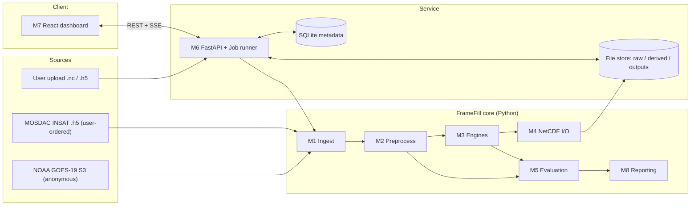
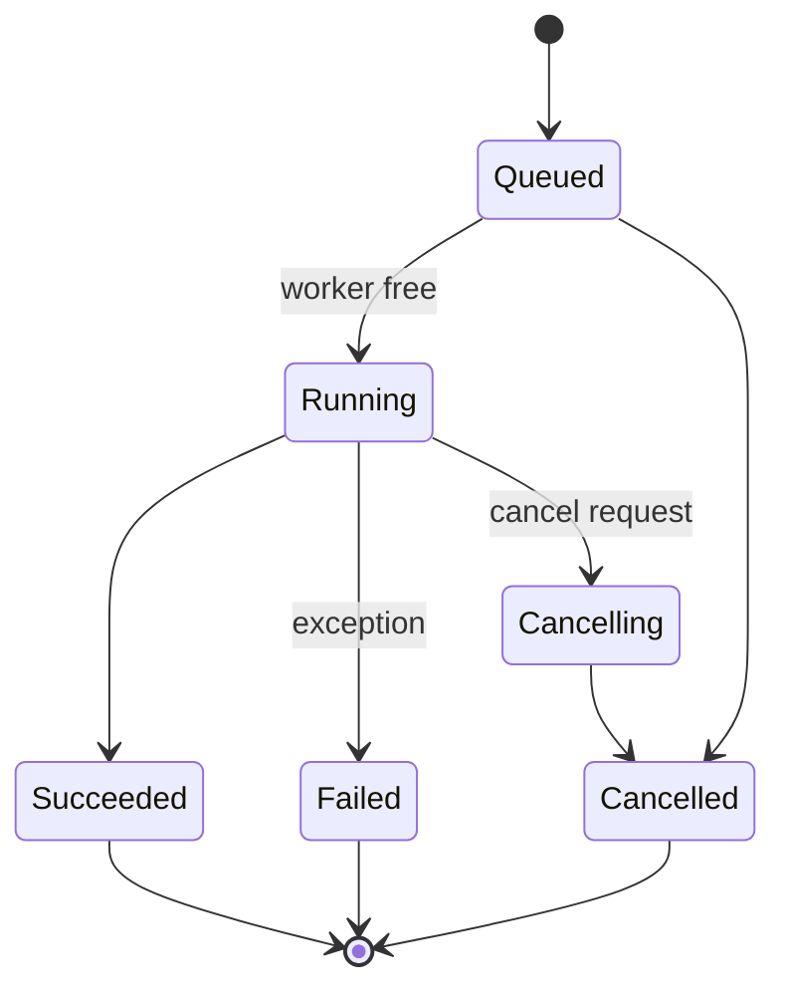
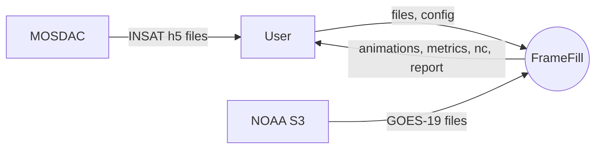
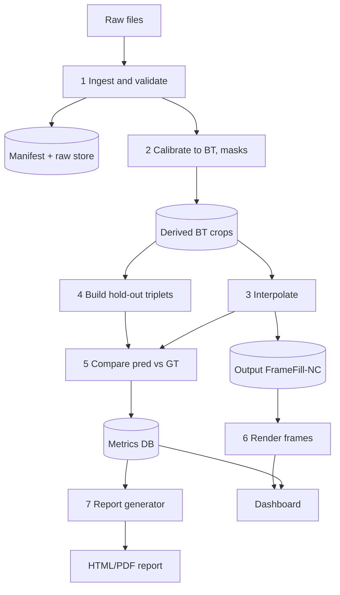
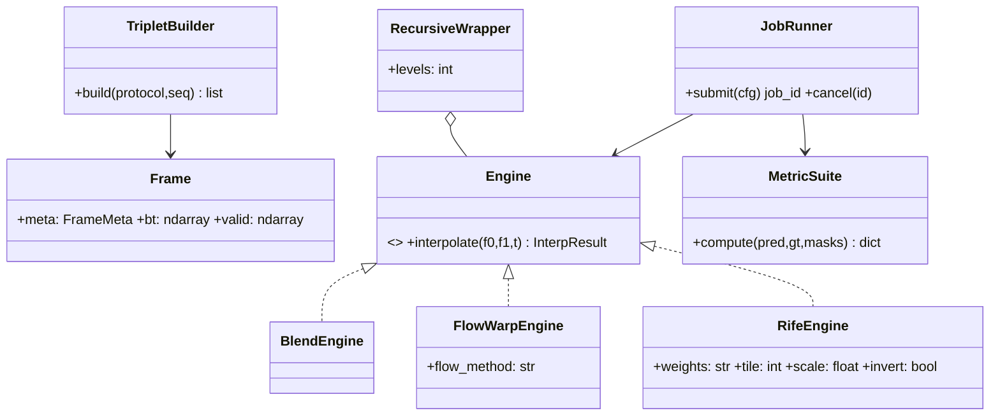
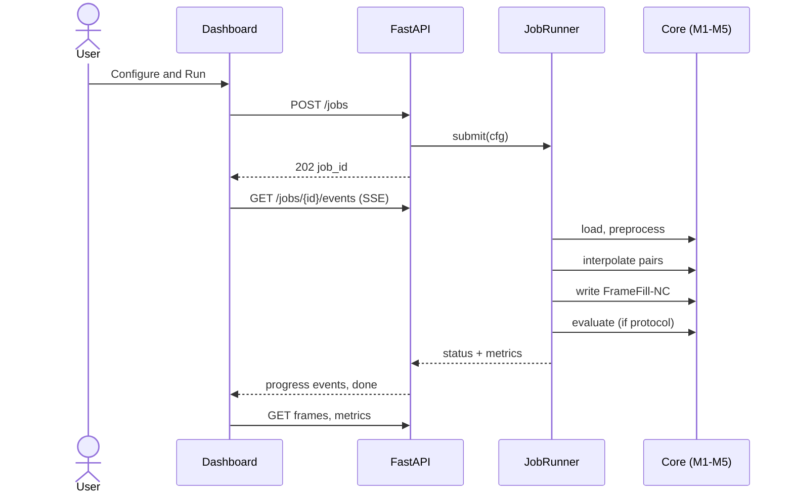
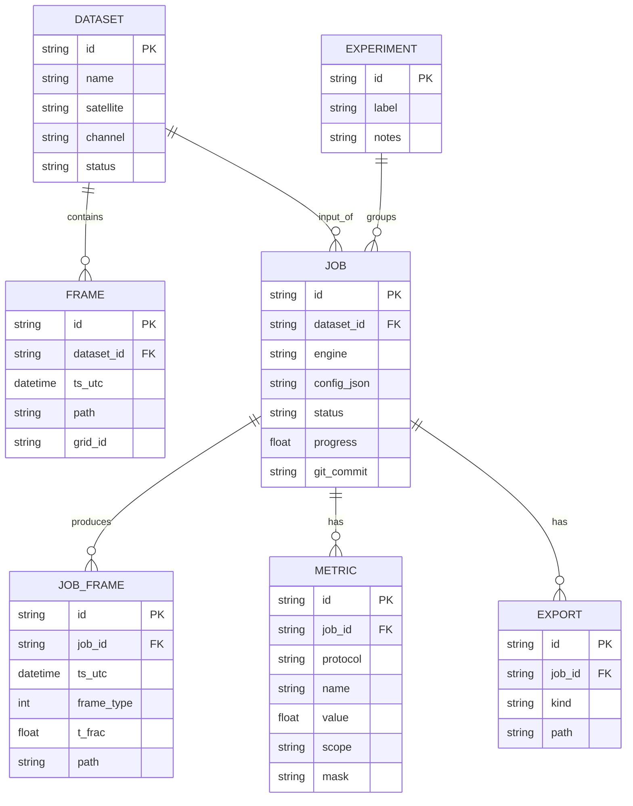

# 03 — System Design (Documents 15–25)

**Package version:** 0.1 Draft · **Date:** 2026-10-25 · Proposed design; not implemented or tested.

## Module catalogue (used by all documents)

| Module | Name | Package path | Responsibility |
|---|---|---|---|
| M1 | Ingest | `framefill/ingest/` | Fetch/read files (GOES-19 `.nc`, INSAT `.h5`, optional Himawari), manifests |
| M2 | Preprocess | `framefill/preprocess/` | BT conversion, masks, cadence/grid checks, normalisation, ROI, tiling |
| M3 | Engines | `framefill/engines/` | `blend`, `flow_warp` (DIS/Farneback/RAFT), `rife` (pretrained/fine-tuned), recursion |
| M4 | NetCDF I/O | `framefill/io/` | FrameFill-NC writer/reader/validator |
| M5 | Evaluation | `framefill/eval/` | Triplets, metrics, masks, experiment runner |
| M6 | API/Jobs | `framefill/api/` | FastAPI, job queue, SQLite, rendering endpoints |
| M7 | Dashboard | `web/` | React front end |
| M8 | Reporting | `framefill/report/` | Plots, HTML/PDF report |

---

## Doc 15 — System Architecture Document
**Version 0.1 · Purpose:** Overall structure and key architectural decisions.



**Key decisions (ADR summary)**
| ADR | Decision | Rationale | Trade-off |
|---|---|---|---|
| ADR-1 | Core library separate from API; CLI and API call the same functions | Testability, reuse in notebooks | Slight boilerplate |
| ADR-2 | In-process job runner (thread pool) + SQLite instead of Celery/Redis | Zero infra for students | Not horizontally scalable |
| ADR-3 | Operate in native satellite pixel grid; no reprojection in MVP | Avoids resampling artefacts; keeps BT faithful | Lat/lon overlays limited to what metadata supports |
| ADR-4 | Server renders colourised PNG; client animates | Keeps browser light; consistent colour scale | More server I/O |
| ADR-5 | Float32 BT end-to-end; no 8-bit quantisation except for display | Scientific fidelity | Slightly more memory |
| ADR-6 | FrameFill-NC is the canonical interchange (PS-06) | One format for engines/eval/export | Converter needed for `.h5` |

**Quality attributes:** reproducibility (config snapshot), integrity (synthetic flag), portability, simplicity.

---

## Doc 16 — High-Level Design (HLD)
**Purpose:** Major components, responsibilities and interfaces.

| Component | Inputs | Outputs | Key interface |
|---|---|---|---|
| Ingest | file paths / S3 keys / uploads | `RawFrame` list + manifest | `load_sequence(paths) -> list[Frame]` |
| Preprocess | `Frame` | `BTFrame` (K, mask, meta) | `to_bt(frame)`, `check_grid(frames)`, `normalise(bt)`, `tile(arr)` |
| Engine | two `BTFrame`, `t` | `BTFrame` synthetic + optional flow | `Engine.interpolate(f0, f1, t) -> InterpResult` |
| NetCDF I/O | `BTFrame` list + flags | `.nc` file | `write_fillnc(frames, path, prov)` |
| Evaluation | triplets, engine | metric tables | `evaluate(engine, triplets, cfg)` |
| API | HTTP | JSON/PNG/files | Doc 23 |
| Dashboard | API | UI | Doc 24 |

**Primary flows:** (F1) ingest→validate→preview; (F2) interpolate→write→animate; (F3) hold-out evaluation→metrics→report; (F4) INSAT application.

---

## Doc 17 — Low-Level Design (LLD)

### 17.1 Core data classes (Python, `dataclasses`/Pydantic)
```python
@dataclass(frozen=True)
class FrameMeta:
    satellite: str          # "GOES-19", "INSAT-3DS", ...
    channel: str            # "C13", "TIR1"
    wavelength_um: float | None
    timestamp: datetime     # UTC, tz-aware
    shape: tuple[int, int]  # (y, x)
    grid_id: str            # hash of projection attrs + x/y coords
    pixel_km_nadir: float | None
    source_file: str
    product_level: str      # "L2-CMIP", "L1B", "L1C", "FillNC"

@dataclass
class BTFrame:
    bt: np.ndarray          # float32 [K], NaN = invalid
    valid: np.ndarray       # bool mask
    meta: FrameMeta

@dataclass
class InterpResult:
    frame: BTFrame          # synthetic (meta.timestamp = interpolated time)
    t: float                # fraction between f0 and f1
    flow_fwd: np.ndarray | None   # (2,H,W) px/frame, if available
    flow_bwd: np.ndarray | None
    engine: str; version: str; runtime_s: float
```

### 17.2 Engine interface and implementations
```python
class Engine(Protocol):
    name: str
    def interpolate(self, f0: BTFrame, f1: BTFrame, t: float = 0.5) -> InterpResult: ...
```
| Engine | Algorithm (pseudo) |
|---|---|
| `BlendEngine` | `bt = (1-t)*f0 + t*f1`; mask = valid0 & valid1 |
| `FlowWarpEngine` | normalise → uint8 *only for flow estimation* (DIS needs 8-bit) while warping is done on float BT; `F01 = flow(I0,I1)`, `F10 = flow(I1,I0)`; approximate `Ft0 = -t·F01`-style linear flow scaling; backward-warp `I0` by `Ft0`, `I1` by `Ft1`; blend `(1-t)·W0 + t·W1`; occlusion weight from forward-backward consistency `‖F01(x)+F10(x+F01(x))‖` |
| `RifeEngine` | pad to multiple of 32 (or model-required); normalise `x=(BT-lo)/(hi-lo)` clip [0,1]; optional polarity invert; replicate to 3 channels; tile (size 512–1024, overlap 64, cosine blend); `model.inference(x0,x1,timestep=t,scale=s)`; average channels; de-normalise; clamp to source range ± guard; restore NaN mask |
| `RecursiveWrapper` | level-2: interpolate between each adjacent pair of {observed + level-1} frames; flags `interp_level` |

**Flow estimation detail:** DIS with preset `MEDIUM`; images converted to 8-bit by fixed-range scaling **for flow only**; the flow is then applied to float32 BT so physical values are preserved.

### 17.3 Evaluation (LLD)
`TripletBuilder.build(protocol, sequence)` returns `Triplet(f_a, f_gt, f_b, dt_min)`; `MetricSuite.compute(pred, gt, masks)` returns dict. Masks: `valid`, `dynamic`, `cold` (Doc 09).

### 17.4 Job lifecycle


### 17.5 Error codes
`E-FORMAT` unsupported file · `E-GRID` grid mismatch · `E-GAP` temporal gap · `E-VAR` variable not found · `E-CAL` calibration failed · `E-GPU` GPU unavailable (warning) · `E-MODEL` weights missing · `E-PROTO` protocol impossible · `E-LIMIT` size limit.

---

## Doc 18 — Data Flow Diagrams

**Level 0**

**Level 1**


---

## Doc 19 — Relevant UML Diagrams

### 19.1 Class diagram

### 19.2 Sequence — run interpolation and validate

### 19.3 Component and deployment views → Doc 49.

---

## Doc 20 — Data Pipeline Design
**Purpose:** Step-by-step pipeline with contracts.

| Step | Name | Input | Output | Checks |
|---|---|---|---|---|
| P0 | Acquire | S3 keys / MOSDAC files | raw files + SHA-256 manifest | file opens; size > 0 |
| P1 | Parse | raw | `Frame` with meta | timestamp parsed; variable found |
| P2 | Calibrate | `Frame` | `BTFrame` (K) | BT range 150–350 K; NaN for fill |
| P3 | Sequence | frames | ordered sequences split at gaps | cadence = median Δt |
| P4 | Grid check | sequence | pass/fail | identical `grid_id` |
| P5 | ROI/crop | `BTFrame` | derived crop | crop inside valid disk |
| P6 | Normalise | crop | `x∈[0,1]` | fixed range, not per-image |
| P7 | Interpolate | pairs | synthetic frames | no NaN introduced inside valid region |
| P8 | Denormalise + guard | synthetic | K values | clamp; log clamp fraction |
| P9 | Write | frames | FrameFill-NC | schema validation |
| P10 | Evaluate | pred, GT | metrics | masks recorded |
| P11 | Render | frames | PNG/animation | colour scale fixed per job |

**INSAT variant (P2):** if the file stores 10-bit counts + a count→temperature LUT, apply the LUT; if it stores BT/radiance directly, use it; the mapping is declared in `configs/insat3ds.yaml` **[verify on a real file]**.

---

## Doc 21 — ML Model Design Document
**Purpose:** Model-level design and rationale.

| Aspect | Design |
|---|---|
| Task | Single-channel video frame interpolation; arbitrary t |
| Primary model | RIFE (IFNet-based) via Practical-RIFE-style inference code **[verify repo, version, licence]** |
| Input | Two BT crops normalised to [0,1], replicated to 3 channels, `float32` |
| Output | Intermediate frame; mean of 3 channels → BT |
| Flow output | IFNet intermediate flows (if exposed) for visualisation; plus explicit DIS/RAFT flow for PS-01 |
| Variants | B2 naive pretrained; B3 with BT normalisation/tiling/polarity ablation; B4 fine-tuned |
| Fine-tune design | Start from pretrained; small LR (e.g. 1e-5–1e-4, to tune); L1 + Laplacian/census-style loss + optional gradient loss; augmentations: flips, rot90, random crop, brightness-offset ±3 K (careful), temporal reversal; train triplets Δ=10 and 20 min (GOES) to vary motion magnitude; freeze first stage optionally |
| Loss in K-space | Report L1 in K; training loss on normalised scale (150 K ≙ 1.0) |
| Hyper-parameter search | Minimal: LR {1e-5,5e-5,1e-4}, epochs {3,10}, freeze {yes,no} → 12 runs max |
| Failure modes | Ghosting at fast edges; smoothing of overshooting tops; spurious texture; non-advective growth missed |
| Safeguards | Value clamping; difference maps; "synthetic" labelling; metric thresholds |
| Explicit non-goals | Extrapolation/nowcasting; super-resolution; cloud-removal |

**Motion-scale reasoning (derived arithmetic):** with winds 10–30 m/s, a 20-min gap implies 12–36 km displacement = 6–18 px at 2 km (GOES), a 30-min gap at 4 km (INSAT) implies 18–54 km = 4.5–13.5 px, and the 60-min P4 gap is 9–27 px. These magnitudes motivate the pyramid `scale` parameter and ROI-size ablations.

---

## Doc 22 — Data Storage and Metadata Schema

### 22.1 File store
```
data/
  raw/            # read-only originals (+ manifest.csv with sha256)
  derived/        # BT crops (FrameFill-NC), masks
  outputs/{job_id}/  # synthetic NC, PNG, GIF/MP4, metrics.csv, report.html
  models/         # weights + MODEL_CARD.md
  db/framefill.sqlite
```
### 22.2 FrameFill-NC (canonical NetCDF) — CF-style, proposed
| Element | Spec |
|---|---|
| Dimensions | `time` (unlimited), `y`, `x` |
| Coordinates | `time` (`seconds since 1970-01-01`, calendar standard); `y`,`x` copied from source (projection coords or pixel index) |
| Variable `brightness_temperature` | `float32(time,y,x)`; `units="K"`; `long_name="Brightness temperature, thermal IR window"`; `_FillValue=NaN`; `valid_min=150`, `valid_max=350`; `grid_mapping` if source has projection; zlib level 4 |
| Variable `frame_type` | `int8(time)`; `flag_values=[0,1,2]`; `flag_meanings="observed interpolated_level1 interpolated_level2"` |
| Variable `interp_fraction` | `float32(time)` — t between bracketing observed frames; NaN for observed |
| Variable `source_time_prev/next` | `float64(time)` — bracketing frame times (for synthetic frames) |
| Global attrs | `Conventions="CF-1.8"`, `title`, `institution` (team), `source_satellite`, `channel`, `source_files` (list), `method`, `model_version`, `config_hash`, `git_commit`, `created_utc`, `history`, `warning="Contains synthetic frames generated by AI interpolation. Not original satellite observations."`, `attribution` (NOAA/JMA/MOSDAC as applicable) |
Validation: opens with xarray and `ncdump -h`; `frame_type` monotone timeline; no synthetic frame at an observed timestamp.

### 22.3 SQLite schema


---

## Doc 23 — API Specification (REST, FastAPI)
**Purpose:** Contract between dashboard and backend. Base path `/api/v1`. JSON unless stated.

| Method & path | Purpose | Request | Response |
|---|---|---|---|
| `GET /health` | Liveness | — | `{status, version}` |
| `GET /system/info` | Device, versions, engines available | — | `{device, torch, engines:[...], weights:[...]}` |
| `POST /datasets` | Upload files (multipart) | files[] | `{dataset_id}` 201 |
| `POST /datasets/register` | Register local paths | `{paths:[...]}` | `{dataset_id}` |
| `POST /datasets/fetch` | *(optional)* fetch GOES-19 C13 | `{start_utc,end_utc,roi}` | `{job_id}` 202 |
| `GET /datasets` / `GET /datasets/{id}` | List / detail (meta, frames, cadence, gaps, warnings) | — | dataset JSON |
| `GET /datasets/{id}/frames/{fid}/preview` | PNG preview | `?cmap&vmin&vmax&w` | `image/png` |
| `POST /jobs` | Create interpolation/eval job | see below | `{job_id}` 202 |
| `GET /jobs` | List jobs (recent first) | `?status&limit` | `[{job_id, dataset_id, engine, status, progress, started, duration}]` |
| `GET /jobs/{id}` | Status | — | `{status, progress, message, error?}` |
| `GET /jobs/{id}/events` | Server-sent events | — | `text/event-stream` |
| `DELETE /jobs/{id}` | Cancel | — | 202 |
| `GET /jobs/{id}/frames` | List original+synthetic frames | — | `[{fid, ts, type, level, t_frac}]` |
| `GET /jobs/{id}/frames/{fid}/image` | Rendered frame | `?cmap&vmin&vmax` | `image/png` |
| `GET /jobs/{id}/frames/{fid}/diff` | Difference map vs GT | `?range=10` | `image/png` + header stats |
| `GET /jobs/{id}/flow/{fid}` | Flow visualisation / vectors | `?mode=hsv|quiver` | PNG or JSON |
| `GET /jobs/{id}/metrics` | Aggregate + per-frame | `?protocol&mask` | metrics JSON |
| `GET /experiments` / `POST /experiments/compare` | List / compare | `{job_ids:[...]}` | comparison table |
| `POST /jobs/{id}/exports` | Request export | `{kind: nc|zip|gif|mp4|csv|report}` | `{export_id}` |
| `GET /exports/{id}` | Download | — | file |
| `POST /jobs/{id}/report` | Build report | `{format: html|pdf}` | `{export_id}` |

**Job request (`POST /jobs`)**
```json
{
  "dataset_id": "ds_001",
  "engine": "rife|flow_warp|blend",
  "engine_options": {"weights": "rife_v4.x", "tile": 1024, "overlap": 64, "scale": 1.0, "invert": false, "flow_method": "dis"},
  "levels": 1,
  "roi": {"y0": 0, "y1": 1024, "x0": 0, "x1": 1024},
  "protocol": {"name": "P1|P4|none", "max_triplets": 200},
  "bt_range": [180, 330],
  "seed": 42
}
```
**Errors:** `{ "error": {"code":"E-GRID","message":"...","details":{}} }` with 4xx/5xx. Auth: none (local); optional API key header if hosted.

---

## Doc 24 — UI/UX Specification and Wireframes (summary)
Full Stitch-ready specification is in `10_UI_Spec_for_Google_Stitch.md`. Screens: S1 Overview · S2 Dataset & Metadata · S3 Configure & Run · S4 Animation Viewer · S5 Frame Compare · S6 Difference & Metrics · S7 Experiments · S8 Export & Report · S9 Architecture/About.
```
+----------------------------------------------------------+
| TopBar: logo | dataset chip | job chip | theme | help      |
+--------+-------------------------------------------------+
| Side   |  S4 Viewer                                       |
| nav    |  +----------------+ +----------------+          |
| S1..S9 |  | Original/GT    | | Interpolated   |  sync     |
|        |  +----------------+ +----------------+          |
|        |  [|<][<][play][>][>|]  speed  loop   timeline     |
|        |  frame badge: OBSERVED / SYNTHETIC L1 / L2        |
+--------+-------------------------------------------------+
```

---

## Doc 25 — Technology Stack and Justification

| Layer | Choice | Why | Alternative |
|---|---|---|---|
| Language | Python 3.11 | Ecosystem | — |
| Numerics | NumPy, SciPy, xarray, netCDF4/h5netcdf, h5py | Native `.nc/.h5` | — |
| Vision/flow | OpenCV (DIS, Farneback), torchvision RAFT (optional) | Mature | — |
| DL | PyTorch ≥ 2.x | RIFE runs on it | — |
| Metrics | scikit-image (SSIM, PSNR); own FSIM or `piq` **[verify install/licence]**; NumPy | Reproducible | `torchmetrics` |
| API | FastAPI + Uvicorn + Pydantic | Typed, SSE-friendly, docs auto-generated | Flask |
| Jobs/storage | `concurrent.futures`, SQLite (SQLAlchemy) | No infra | Celery+Redis |
| Rendering | Matplotlib colormaps → Pillow PNG | Colour-blind-safe maps | — |
| Front end | React + Vite + TypeScript + Tailwind; charts via Plotly.js or ECharts | Stitch output maps well | Svelte |
| Report | Jinja2 + Matplotlib → HTML; WeasyPrint for PDF (optional) | Simple | LaTeX |
| Tests | pytest, hypothesis (optional), Playwright (UI smoke) | Standard | — |
| Quality | ruff, black, mypy, pre-commit | Consistency | — |
| Packaging | `pyproject.toml`, conda/uv; Docker Compose | Reproducible | — |
| Experiment tracking | CSV/JSON + MLflow-lite (optional) or Weights & Biases free tier **[verify terms]** | Traceable | — |
| Geodata (optional) | pyproj, cartopy (overlays); satpy for Himawari HSD | Only if overlays/Himawari used | — |

**Compatibility note:** pin a PyTorch build matching the installed CUDA/driver, or use CPU wheels; RIFE inference code often requires specific `torch` features — freeze versions after the first successful run (Doc 36).
