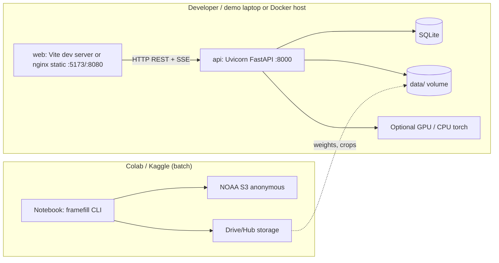

# 07 — Deployment and Maintenance (Documents 46–56)

**Package version:** 0.1 Draft · **Date:** 2026-10-25 · Proposed; nothing has been deployed or released.

---

## Doc 46 — Deployment Plan
**Purpose:** How FrameFill is delivered for demonstration and handover.

| Target | Description | Priority | Limitations |
|---|---|---|---|
| T1 Local (laptop) | Python env + `npm run dev`, or Docker Compose | **Primary** | Needs the user's own data/weights |
| T2 Colab/Kaggle notebook | CLI pipeline for GPU runs (fine-tune, batch eval) | Primary for training | Sessions are ephemeral; no persistent web UI |
| T3 Hosted demo (optional) | Static dashboard + small precomputed results on a free host (e.g., Hugging Face Space CPU, GitHub Pages for static results) **[verify current free-tier limits]** | Optional | No live heavy inference; precomputed examples only; no redistribution of full data |
| T4 Offline demo bundle | ZIP with sample data crops, weights, results, and a video | Required for judging backup | Size limits |

**Deployment steps (T1):** clone → create env → download weights → place sample data → start API → start web → open `http://localhost:5173`.
**Rollback:** tag-based; keep last good `v0.x` Docker image/tar.
**Go-live checklist:** CI green; TC-063/065 pass; sample dataset included; limitations banner present; licences listed.

---

## Doc 47 — Installation and Setup Guide
**Purpose:** Reproducible setup instructions (commands are templates; adapt names).

### Prerequisites
Python 3.11, Git, Node 20, 8 GB RAM minimum (16 GB recommended), ≥ 20 GB free disk; GPU optional.

### Steps
```bash
# 1. Get code
git clone <repo-url> framefill && cd framefill

# 2. Python environment (choose one)
conda create -n framefill python=3.11 -y && conda activate framefill
pip install -e ".[dev]"                      # core + dev deps
# GPU users: install a PyTorch build matching your CUDA first, from pytorch.org instructions

# 3. Weights
python scripts/get_weights.py                # downloads to models/ and verifies SHA-256

# 4. Sample data (tiny crops shipped in the offline bundle)
python scripts/get_sample_data.py            # or copy from the bundle to data/raw/

# 5. Optional: GOES-19 sample fetch (anonymous S3; needs internet)
framefill fetch-goes19 --start 2026-01-15T00:00Z --end 2026-01-15T02:00Z --channel 13 --roi 0,1024,0,1024

# 6. Run API
uvicorn framefill.api.main:app --reload --port 8000

# 7. Run web
cd web && npm install && npm run dev         # http://localhost:5173

# 8. CLI sanity run
framefill run --config configs/experiments/EXP-05.yaml
```
*(The date in step 5 is a placeholder; pick dates after confirming availability with `aws s3 ls --no-sign-request`.)*
**MOSDAC:** register at mosdac.gov.in, wait for approval, order INSAT-3DS Imager data, download via SFTP/API, then `framefill register --path data/raw/insat/`. Put credentials only in `.env`.
**Troubleshooting:** `E-VAR` → run `framefill inspect file.h5` and edit `configs/insat3ds.yaml`; CUDA mismatch → reinstall matching torch; netCDF4 import error on Windows → use conda.

---

## Doc 48 — Release and Versioning Plan

| Item | Rule |
|---|---|
| Scheme | Semantic Versioning `MAJOR.MINOR.PATCH` |
| Planned releases | `v0.1.0` MVP-core (Week 4) · `v0.2.0` MVP-plus (Week 5) · `v1.0.0` final submission |
| Artefacts | Source tag, Docker images, offline bundle ZIP, evaluation report PDF/HTML, model weights with SHA-256 |
| Release notes | Changes, known issues, validated metrics (with EXP IDs), data/weights versions |
| Model versioning | `rife_ff_v<MAJOR>.<MINOR>`; linked to training config and data manifest |
| Data versioning | Manifest hash; dataset version string in outputs |
| Release checklist | Tests pass; docs updated; CHANGELOG; licences; version bump; tag; artefacts built; smoke test on clean env |

---

## Doc 49 — Deployment Architecture

**Docker Compose services:** `api` (python:3.11-slim + deps; GPU variant optional), `web` (node build → nginx). Volumes: `./data`, `./models`. Ports: 8000, 8080.
**Security:** local binding by default; no auth; CORS = `http://localhost:*`; upload limits; no outbound calls except explicit S3 fetch.

---

## Doc 50 — User Manual (outline with content)

1. **What FrameFill does and does not do** — creates *synthetic* intermediate frames between two observed TIR frames; not an observation; not for forecasting.
2. **Quick start** — open dashboard → S2 *Datasets* → add sample → S3 *Run* → choose engine → run → S4 *Viewer*.
3. **Reading the viewer** — badges (OBSERVED, SYNTHETIC L1, SYNTHETIC L2); colour scale (K, fixed); sync controls; ground-truth mode.
4. **Understanding metrics** — MAE/RMSE in K (smaller = better); PSNR/SSIM/FSIM (higher = better, but sensitive to static background); *Dynamic* and *Cold-cloud* subsets; skill vs B0; what N and CI mean.
5. **Difference maps** — blue = prediction colder, orange = prediction warmer than observation (colour-blind-safer pair); scale ±10 K default.
6. **Experiments** — compare engines; only compare runs with the same protocol and split.
7. **Exports** — `.nc` (FrameFill-NC with synthetic flags), PNG zip, GIF/MP4, CSV, report.
8. **INSAT-3DS page** — 15-min and 7.5-min outputs are not validated by ground truth.
9. **Limitations and responsible use** — see Model Card.
10. **FAQ/Troubleshooting** — error codes (Doc 17.5).

---

## Doc 51 — Developer Documentation
**Purpose:** Orient contributors.

| Topic | Content |
|---|---|
| Architecture | Doc 15–17 |
| Adding an engine | Implement `Engine` protocol; register in `engines/__init__.py`; add YAML under `configs/engines/`; add tests TC-024-style; add to API schema enum |
| Adding a satellite/loader | Implement `load_frame()` returning `Frame`; add mapping config; add fixture; update data dictionary |
| Adding a metric | Add to `eval/metrics.py` with unit test vs reference; add to data dictionary; update UI table |
| Running experiments | `framefill eval --config configs/experiments/EXP-xx.yaml` → `experiments/EXP-xx/` |
| API changes | Update Pydantic schema → regenerate OpenAPI → regenerate TS client |
| Debugging | `LOG_LEVEL=DEBUG`; `framefill inspect <file>`; fixtures under `tests/fixtures` |
| Release | Doc 48 |

---

## Doc 52 — Maintenance and Support Plan

| Area | Plan |
|---|---|
| Corrective | Defects per Doc 44; hotfix branch from tag |
| Adaptive | Dependency updates monthly (Dependabot); watch changes in NOAA bucket layout, GOES product versions, MOSDAC file formats; Himawari operational changes |
| Perfective | Backlog: more engines (FILM/AMT), full-disk tiling, more sensors (e.g., INSAT-3DR sector), lat/lon overlays |
| Preventive | Pinned lockfile; CI; sample-data regression metrics |
| Support | Team email/issue tracker; response target 2 working days (proposed) |
| Data/model refresh | Re-validate on new seasons before re-release |
| Handover | Docs + demo video + offline bundle + contact list; designate a maintainer |
| End of life | Archive repo with final tag and README note on limitations |

---

## Doc 53 — Change Request Log (template)

| CR ID | Date | Requested by | Description | Reason | Impact (scope/schedule/cost/risk) | Docs affected | Decision (Approve/Reject/Defer) | Decided by | Implemented in |
|---|---|---|---|---|---|---|---|---|---|
| CR-001 | | | | | | | | | |
Process: raise → R4 triage within 2 days → impact analysis by owner → team decision (R4 tie-break; mentor consulted) → update RTM and affected docs. After scope freeze (Week 4), only Critical CRs are approved.

---

## Doc 54 — Final Project Report Structure
1. Title, team, institution, date · 2. Abstract (≤200 words) · 3. Problem and PS mapping (PS-01…PS-14) · 4. Related work · 5. Data (sources, dates, ROI, splits, licences) · 6. Method (preprocessing, engines B0–B4, recursion) · 7. System (architecture, API, UI) · 8. Evaluation methodology (protocols P1–P4, metrics, masks) · 9. Results (tables/plots, with N, CIs) · 10. INSAT-3DS application (with explicit caveats) · 11. Limitations and risks · 12. Testing summary · 13. Resource use (compute, cost) · 14. Conclusions and future work · 15. References · Appendices: configs, EXP table, test report, user manual, model card, traceability matrix.
**Rule:** every number in §9–10 cites an EXP ID.

---

## Doc 55 — Lessons Learned Template

| Category | What went well | What did not | Root cause | Action for next time | Owner |
|---|---|---|---|---|---|
| Planning & scope | | | | | |
| Data access (MOSDAC/AWS) | | | | | |
| Modelling & validation | | | | | |
| Engineering & testing | | | | | |
| Collaboration | | | | | |
| Time/compute | | | | | |
Run a 60-minute retrospective after the freeze; record within one week.

---

## Doc 56 — Final Presentation and Demonstration Plan

**Time box:** 10 min talk + 5 min demo + Q&A (adjust to the organiser's format).

| Min | Content |
|---|---|
| 0–1 | Problem: cadence gap and why it matters |
| 1–3 | Approach: flow baselines → RIFE → adaptation for BT; synthetic labelling |
| 3–5 | Validation design: hold-out frames; metrics; baselines |
| 5–7 | Results: tables/plots **(measured only)**; failure cases shown honestly |
| 7–9 | INSAT-3DS 15-min animation with caveats |
| 9–10 | System, limits, future work |
| Demo (5) | Upload sample → run → synced animation → difference map → export `.nc` |

**Backup plan:** pre-recorded 3-min video; precomputed results bundle; screenshots in slides; offline laptop with local run.
**Likely questions and prepared answers:** Why not train from scratch? How do you know interpolated values are physical? What happens with new cloud formation? Why SSIM alone is insufficient? How does GOES-trained behaviour transfer to INSAT?
**Roles:** R1 method, R3 validation, R2 data/INSAT, R4 demo driver.
